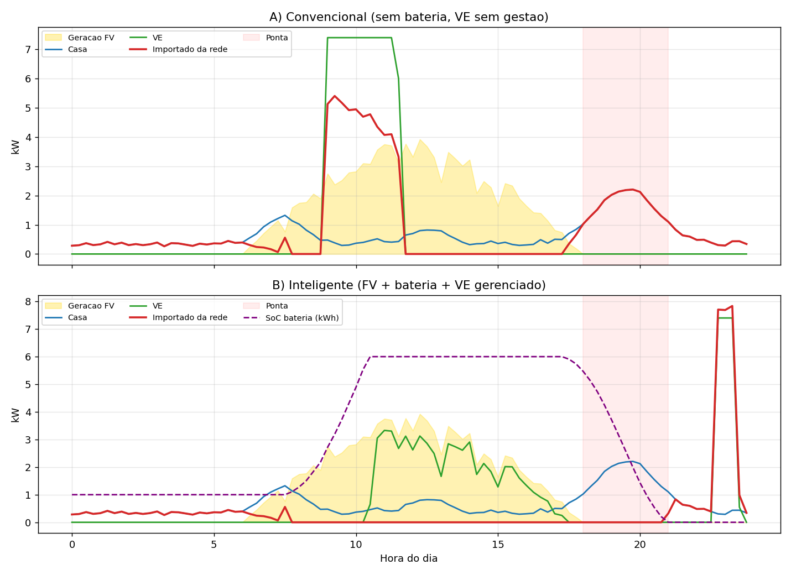
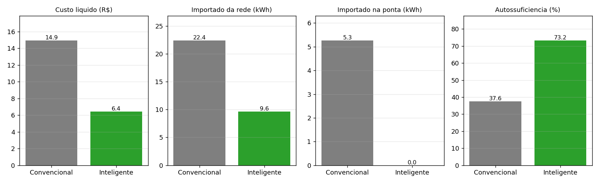

# sprint4.py
-------------
# Gestão Inteligente de Energia Solar, Armazenamento e Recarga de VE (Sprint 4 – Goodwe)

> Solução integrada que coordena **geração fotovoltaica + bateria + carregador de veículo elétrico (VE)** com prioridade ao excedente solar e à tarifa horária, no padrão de operação de um inversor híbrido Goodwe.

## 1. Equipe

| Nome | RM |
|---|---|
| Lucas Furquim Lima | 568690 |
| Diogo Chiaradia | 570246 |
| Gustavo Torres de Oliveira | 572952 |
| Rafael Laprega | 561975 |

## 2. Visão geral

Um VE carregando sem gestão consome da rede justamente quando o sol não cobre a carga e, muitas vezes, na tarifa de ponta, enquanto o excedente solar é exportado a um valor baixo. A solução decide **quando, de onde e com que potência** cada kWh é usado.

Este repositório contém:

| Arquivo | Função |
|---|---|
| `simulador.py` | Simulador de 24 h (passos de 15 min) com os cenários Convencional × Inteligente |
| `resultados.csv` | Métricas geradas pela simulação |
| `grafico_comparativo.png` | Curvas de potência dos dois cenários |
| `grafico_metricas.png` | Barras comparando custo, importação, ponta e autossuficiência |

Como executar:

```bash
pip install numpy matplotlib
python simulador.py
```

## 3. Arquitetura

```
 ┌──────────────┐     ┌─────────────────────────────┐     ┌──────────────┐
 │ Painéis FV   │────▶│ Inversor híbrido (gestor)   │────▶│ Casa (carga) │
 │ 5 kWp        │     │ regras de prioridade        │     └──────────────┘
 └──────────────┘     │ + leitura de tarifa horária │     ┌──────────────┐
 ┌──────────────┐◀───▶│                             │────▶│ Wallbox VE   │
 │ Bateria      │     └──────────────┬──────────────┘     │ 7,4 kW       │
 │ 10 kWh       │                    │                    └──────────────┘
 └──────────────┘             ┌──────▼──────┐
                              │ Rede (CA)   │  importa / exporta
                              └─────────────┘
```

**Lógica de decisão (cenário inteligente), em ordem de prioridade para o excedente solar:**

1. Atender a casa com o FV.
2. Carregar a bateria até a **reserva de ponta** (6 kWh), para cobrir a casa entre 18h e 21h.
3. Carregar o VE com o excedente solar.
4. Completar a bateria.
5. Exportar apenas o que sobrar.

**Regras adicionais:** a bateria só descarrega fora da tarifa mais barata; o VE nunca é carregado da rede na ponta; o complemento da rede é feito **o mais tarde possível**, em horário fora de ponta, e só quando o tempo restante exige (garante que o VE saia carregado).

### Parâmetros do modelo

| Item | Valor |
|---|---|
| Potência FV | 5 kWp (PR 80%) |
| Bateria | 10 kWh, 5 kW, rendimento 95% por sentido |
| Wallbox | 7,4 kW |
| Necessidade do VE | 20 kWh, conectado das 9h às 23h45 (dia de home office) |
| Tarifa (ilustrativa) | R$ 0,65 fora de ponta · R$ 0,95 intermediário · R$ 1,60 ponta · R$ 0,40 exportação |
| Fator de emissão da rede | 0,06 kgCO₂/kWh (ilustrativo) |

## 4. Alinhamento ao desafio Goodwe e à disciplina

| Elemento da solução | Tecnologia Goodwe compatível | Conceito da disciplina |
|---|---|---|
| Gestão FV + bateria + carga | Inversores híbridos (linha ET/EH) | Automação e regras de decisão |
| Armazenamento | Baterias Lynx Home | Eficiência e balanço de energia |
| Recarga de VE | Wallbox Goodwe (linha HCA) | Integração de sistemas |
| Monitoramento e visualização | Plataforma SEMS Portal | Visualização de dados |
| Algoritmo de prioridade/tarifa | Modos de operação do inversor | Algoritmos inteligentes |

## 5. Resultados (simulação de 1 dia)

Dados sintéticos com semente fixa (reprodutíveis). Saída de `python simulador.py`:

| Métrica | Convencional | Inteligente |
|---|---:|---:|
| Geração FV (kWh) | 25,78 | 25,78 |
| Consumo total (kWh) | 35,84 | 35,84 |
| Importado da rede (kWh) | 22,36 | 9,62 |
| Exportado (kWh) | 12,30 | 0,00 |
| Importado na ponta (kWh) | 5,26 | 0,00 |
| Pico de importação (kW) | 5,41 | 7,84 |
| Autoconsumo FV (%) | 52,3 | 100,0 |
| Autossuficiência (%) | 37,6 | 73,2 |
| Custo líquido do dia (R$) | 14,92 | 6,43 |
| CO₂ da rede (kg) | 1,34 | 0,58 |

**Redução de custo: 56,9%** · **Importação da rede: −57%** · **Importação na ponta: zerada** · VE 100% carregado nos dois cenários.

**Curvas de potência ao longo do dia:**



**Métricas principais lado a lado:**



**Leitura qualitativa:** no cenário A o VE entra às 9h, puxa até 5,4 kW da rede e a casa ainda importa na ponta. No cenário B o VE acompanha a curva solar, a bateria cobre a ponta e a rede só entra às 22h30, na tarifa mais barata.

## 6. Avaliação crítica

- **Sustentabilidade:** a redução de CO₂ existe, mas é pequena em valor absoluto, porque a matriz elétrica brasileira já é majoritariamente renovável (≈0,6 kg/dia evitado). O ganho principal aqui é **econômico e de uso da rede**, não de carbono.
- **Limitação do modelo:** o cenário é favorável (VE em casa durante o dia, 20 kWh de necessidade). Para um VE que só chega à noite, o ganho seria bem menor e viria quase só da bateria e da tarifa.
- **Trade-off:** o pico de importação subiu (5,4 → 7,8 kW), pois a recarga noturna concentra potência. Em instalação real, isso pode ser limitado pela potência da wallbox ou pela demanda contratada.
- **Dados simulados:** geração, consumo e tarifas são sintéticos. Validar com dados medidos (SEMS Portal) e com a tarifa real da distribuidora.
- **Não modelado:** degradação da bateria, previsão do tempo, dias nublados, regras de compensação (Lei 14.300).
- **Inovação:** prioridade ao excedente solar, reserva de bateria para a ponta e recarga "no último momento" fora de ponta, tudo em um único algoritmo.

## 7. Ferramentas e referências

- Python 3, NumPy, Matplotlib
- Goodwe: documentação de inversores híbridos, baterias Lynx Home, wallbox e SEMS Portal (goodwe.com)
